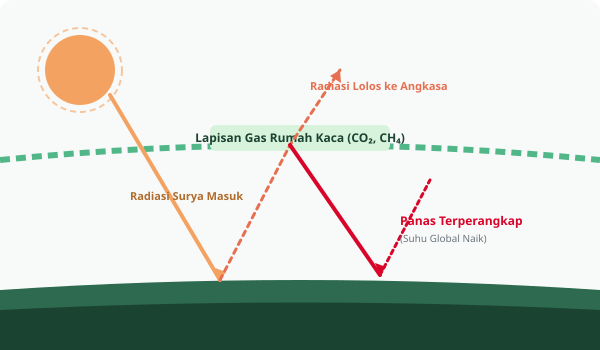

# Klimatika - Platform Edukasi Aksi Iklim (SDG 13)
> Tugas Proyek Ujian Tengah Semester (UTS) - Pemrograman Web  
> Pengembangan Website Edukasi Masyarakat Menggunakan HTML5 Semantik dan CSS3 Murni (Tanpa Framework, Tanpa JavaScript).

---

## 1. Identitas Kelompok dan Pembagian Tugas

1. Mata Kuliah: Pemrograman Web
2. Bentuk Tugas: Proyek Kelompok UTS (3 Mahasiswa)
3. Kelas: 3DPS
4. Program Studi: Sistem Informasi

### Tabel Pembagian Tugas:

| No. | Nama Mahasiswa | NIM | Pembagian Tugas Utama |
| :---: | :--- | :---: | :--- |
| 1 | Cok Agung Aris Mahaputra | 2515091077 | Menyusun halaman Beranda (`index.html`) dan Edukasi (`edukasi.html`), serta merapikan materi sains iklim. |
| 2 | Kadek Restu Yoga Dharma Putra | 2515091130 | Merancang tata letak dan tampilan visual website (`css/style.css`), serta menyusun halaman Panduan Aksi (`panduan.html`). |
| 3 | I Gusti Ngurah Tirtha Vandhita Vinayaka | 2515091089 | Menyusun halaman Artikel (`artikel.html`), halaman Tentang Tim (`tentang.html`), menguji tampilan, dan menyusun `README.md`. |

---

## 2. Judul Proyek, Tema SDGs, dan Sasaran Pengguna

1. Judul Website: Klimatika (Edukasi Aksi Iklim dan Gaya Hidup Rendah Karbon)
2. Tema Pilihan: Tema 10: Aksi Iklim (SDG 13: Penanganan Perubahan Iklim)
3. Keterkaitan SDGs: SDG 14 (Konservasi Laut dan Pesisir) dan SDG 12 (Konsumsi Bertanggung Jawab)
4. Sasaran Pengguna: 
   a. Masyarakat umum yang ingin memahami sains perubahan iklim melalui bahasa sederhana dan visual yang jelas.
   b. Generasi muda dan pelajar yang mencari panduan praktis untuk mengurangi jejak emisi harian.
   c. Pendidik dan komunitas yang membutuhkan studi kasus nyata dampak perubahan iklim di Indonesia.

---

## 3. Tujuan, Manfaat, dan Deskripsi Halaman

### A. Tujuan Proyek
1. Membangun website responsif yang mengedukasi publik mengenai urgensi penanganan perubahan iklim.
2. Menerapkan struktur HTML5 semantik dan CSS3 modern secara mandiri tanpa menggunakan framework siap pakai maupun JavaScript.

### B. Manfaat Proyek
1. Memberikan literasi lingkungan yang mudah dipahami bagi masyarakat luas.
2. Melatih pemahaman praktis mahasiswa dalam membangun website multipage yang terstruktur rapi dan responsif di berbagai ukuran layar.

### C. Deskripsi 5 Halaman
1. `index.html` (Beranda): Memuat hero banner pengantar, empat kartu indikator darurat iklim global (+1.15°C suhu, 422 ppm CO₂, 3.7 mm/th air laut, 3000+ cuaca ekstrem), tiga kartu modul yang dapat diklik ke halaman lain, dan banner ajakan aksi.
2. `edukasi.html` (Edukasi): Membahas perbedaan cuaca vs iklim (standar 30 tahun WMO), diagram efek rumah kaca, empat jenis gas rumah kaca utama, dan proporsi sektor penyumbang emisi terbesar.
3. `panduan.html` (Panduan Aksi): Menyajikan empat pilar aksi rumah tangga (listrik, mobilitas, pangan, sampah), tabel matriks prioritas aksi dengan estimasi penurunan emisi tahunan, dan diagram langkah pengomposan dapur.
4. `artikel.html` (Artikel dan Kasus): Memuat artikel studi kasus abrasi pesisir Pantura Jawa, dampak anomali musim tanam bagi petani, potensi transisi energi terbarukan, serta akordion tanya jawab (FAQ).
5. `tentang.html` (Tentang Tim): Berisi tujuan proyek, identitas 3 mahasiswa pengembang beserta pembagian tugas, daftar pustaka ilmiah kredibel, dan keterangan lisensi aset.

---

## 4. Teknologi yang Digunakan

1. HTML5 Semantik: Menggunakan tag terstruktur (`header`, `nav`, `main`, `section`, `article`, `table`, `details`, `summary`, `footer`).
2. CSS3 Murni:
   a. CSS Custom Properties (Variables) untuk pengaturan warna, font, dan bayangan.
   b. Flexbox untuk tata letak satu dimensi (header, menu navigasi, hero, footer).
   c. CSS Grid untuk penataan kartu dan kolom konten.
   d. CSS Checkbox Hack untuk membuka-tutup menu mobile tanpa JavaScript.
   e. Media Queries untuk penyesuaian tampilan Desktop (1440px), Tablet (768px), dan Smartphone (375px).
3. Grafis Vektor SVG: Seluruh logo dan ilustrasi disimpan dalam format SVG mandiri di folder `images/` dan dipanggil menggunakan tag `` standar.
4. GitHub Pages: Media publikasi daring gratis untuk repositori publik.

---

## 5. Penjelasan Penting Implementasi Teknis dan Potongan Kode

Berikut penjelasan fungsi bagian kode penting yang digunakan pada website ini:

### A. Navigasi Responsif Murni CSS (Checkbox Hack)
Pada layar smartphone, menu navigasi disembunyikan secara default dan dapat dimunculkan menggunakan tombol menu yang terhubung ke input checkbox tersembunyi.

Potongan Kode HTML:
```html
<input type="checkbox" id="nav-toggle" class="nav-toggle">
<label for="nav-toggle" class="nav-toggle-btn">Menu</label>

<nav class="nav-menu">
  <a href="index.html" class="nav-link">Beranda</a>
  <a href="edukasi.html" class="nav-link">Edukasi</a>
</nav>
```

Potongan Kode CSS:
```css
@media (max-width: 768px) {
  /* Menu disembunyikan pada layar kecil */
  .nav-menu {
    display: none;
    flex-direction: column;
  }

  /* Saat checkbox dicentang, ubah display menjadi flex */
  .nav-toggle:checked ~ .nav-menu {
    display: flex;
  }
}
```
Fungsi: Membuka dan menutup menu navigasi di smartphone murni dengan selektor CSS `:checked` tanpa membutuhkan kode JavaScript.

---

### B. Tata Letak Fleksibel (Flexbox)
Flexbox digunakan untuk komponen yang berorientasi satu arah, seperti bilah navigasi dan spanduk hero.

Potongan Kode CSS:
```css
.hero-layout {
  display: flex;
  align-items: center;
  justify-content: space-between;
  gap: 3rem;
}

.hero-text {
  flex: 1 1 55%;
}

.hero-image {
  flex: 1 1 45%;
}
```
Fungsi: Menjaga keseimbangan proporsi antara teks dan gambar spanduk agar sejajar horizontal di layar desktop dan tertata rapi vertikal di layar ponsel.

---

### C. Tata Letak Kartu Berbasis Grid (CSS Grid)
CSS Grid digunakan untuk menyusun kartu informasi dalam beberapa kolom yang rapi.

Potongan Kode CSS:
```css
.grid-3 {
  display: grid;
  grid-template-columns: repeat(3, 1fr);
  gap: 2rem;
}

@media (max-width: 768px) {
  .grid-3 {
    grid-template-columns: 1fr;
  }
}
```
Fungsi: Menghasilkan susunan 3 kolom pada layar komputer yang secara otomatis beralih menjadi 1 kolom vertikal saat dibuka melalui ponsel pintar.

---

### D. Kartu Modul yang Dapat Diklik Utuh (Clickable Card)
Untuk memudahkan akses pengunjung, seluruh area kartu modul di Beranda dijadikan tautan langsung.

Potongan Kode HTML:
```html
<a href="edukasi.html" class="card card-clickable">
  <div class="card-image-box">
    
  </div>
  <div class="card-body">
    <h3 class="card-title">Mekanisme Efek Rumah Kaca dan Emisi</h3>
    <p class="card-text">Pahami perbedaan cuaca alami dan perubahan iklim...</p>
    <div class="card-footer">
      <span class="btn btn-secondary btn-card">Buka Materi Edukasi</span>
    </div>
  </div>
</a>
```
Fungsi: Pengunjung dapat mengeklik di bagian mana saja pada kartu (gambar, teks, maupun tombol) untuk langsung berpindah ke halaman tujuan.

---

### E. Akordion Tanya Jawab Semantik
Menggunakan tag bawaan HTML5 untuk membuat daftar tanya jawab yang interaktif tanpa JavaScript.

Potongan Kode HTML:
```html
<details class="faq-item" open>
  <summary class="faq-question">Apakah kenaikan suhu global 1.5°C benar-benar berdampak sangat buruk?</summary>
  <div class="faq-answer">
    <p>Ya, sangat signifikan. Kenaikan 1.5°C melipatgandakan kejadian cuaca ekstrem...</p>
  </div>
</details>
```
Fungsi: Menampilkan fitur buka-tutup teks secara native yang ringan dan ramah aksesibilitas.

---

## 6. Struktur Folder Repositori

```
UTS-PemrogramanWeb/
├── index.html               # Halaman Beranda
├── edukasi.html             # Halaman Edukasi Sains Iklim
├── panduan.html             # Halaman Panduan Aksi dan Matriks Emisi
├── artikel.html             # Halaman Artikel dan Studi Kasus
├── tentang.html             # Halaman Profil Tim dan Referensi
├── css/
│   └── style.css            # Stylesheet CSS Terpadu
├── images/                  # Aset Grafis Vektor SVG
│   ├── logo.svg             # Logo Identitas Klimatika
│   ├── avatar-default.svg   # Fallback Foto Profil Tim
│   ├── hero-climate.svg     # Ilustrasi Hero Banner
│   ├── greenhouse.svg       # Diagram Efek Rumah Kaca
│   ├── carbon-footprint.svg # Ilustrasi Jejak Karbon
│   ├── coastal-threat.svg   # Ilustrasi Studi Kasus Pesisir
│   ├── article-crop.svg     # Ilustrasi Dampak Pertanian
│   ├── article-energy.svg   # Ilustrasi Transisi Energi Bersih
│   └── compost.svg          # Diagram Siklus Pengomposan Dapur
└── README.md                # Dokumentasi Resmi Proyek
```

---

## 7. URL Website dan Repositori

1. URL Repositori GitHub: https://github.com/Riz-t/Klimatika
2. URL Website (GitHub Pages): https://riz-t.github.io/Klimatika/

---

## 8. Referensi Konten dan Atribusi Aset

### A. Sumber Data Ilmiah:
1. IPCC (Intergovernmental Panel on Climate Change): Sixth Assessment Report (AR6). https://www.ipcc.ch/
2. Badan Meteorologi, Klimatologi, dan Geofisika (BMKG): Laporan Iklim Historis Indonesia. https://www.bmkg.go.id/
3. Kementerian Lingkungan Hidup dan Kehutanan (KLHK): Laporan Inventarisasi Gas Rumah Kaca. https://ditjenppi.menlhk.go.id/
4. Badan Riset dan Inovasi Nasional (BRIN): Kajian Kerentanan Pesisir Pantura Jawa. https://www.brin.go.id/
5. NASA Global Climate Change: Vital Signs of the Planet. https://climate.nasa.gov/

### B. Atribusi Aset:
1. Seluruh ilustrasi grafik SVG di folder `images/` berlisensi terbuka Creative Commons Attribution (CC BY 4.0).
